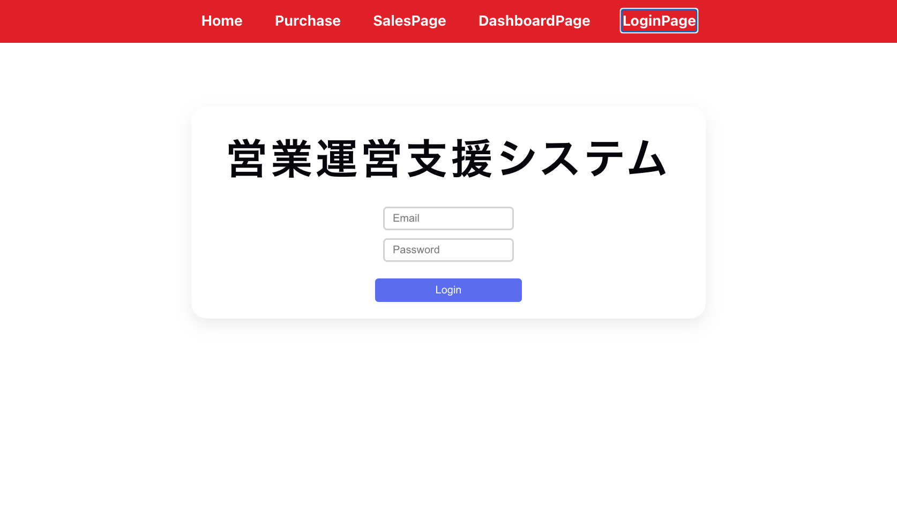
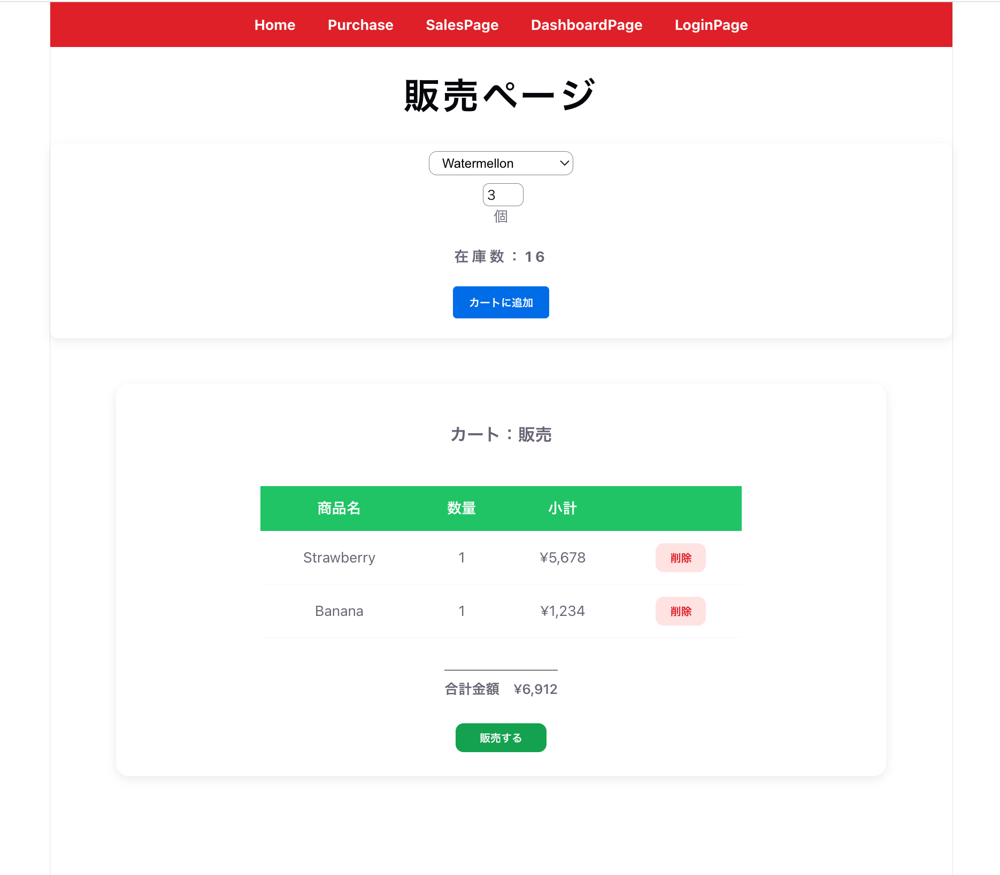
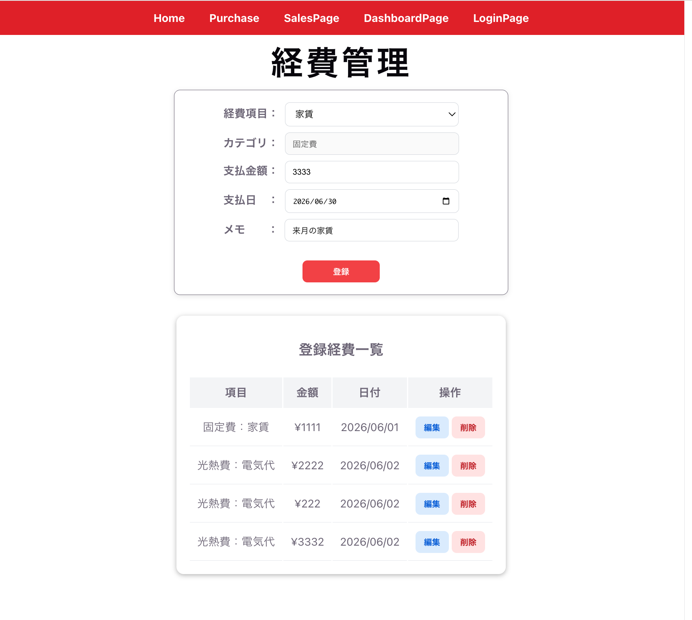

# README

# プロジェクト名：営業運営支援システム
###　          〜販売・仕入・経費・在庫を一元管理するWebアプリケーション〜
 
## 概要
- 小規模店舗や食堂などを対象とした営業運営支援システムです。
- 商品管理、仕入、売上、経費管理を一元管理し、
- ダッシュボード上で売上・利益・キャッシュフローなどの経営指標を
- 可視化できます。

## デモ / URL
#### ログインページ

#### 仕入管理

#### 販売管理

#### ダッシュボード

#### 経費管理

## 背景・目的
販売・仕入・在庫管理が分断されていることによる業務の非効率を課題とし、各データを一元管理するとともに、売上・利益・キャッシュフローを可視化することで、経営状況の把握を容易にすることを目的としました。
 
## 機能一覧
### ログイン
- ログイン認証
### 販売
- 商品販売
- 販売用カート
### 仕入
- 商品仕入
- 仕入用カート
### 経費
- 登録
- 編集
- 削除
### ダッシュボード
- 売上推移
- 仕入推移
- 利益推移
- キャッシュフロー
- 売上TOP３
- 滞留在庫
### Toast通知
 
## 技術スタック
#### Frontend
- React
- Vite
#### Backend
- Node.js
- Express
#### Database
- PostgreSQL

#### Others
- React Router
- bcrypt
- react-hot-toast

## 工夫した点
販売・仕入・経費を独立した機能として実装しながら、
各データを一元管理することで、
売上・利益・キャッシュフローへ自動反映される構成としました。

これにより、業務入力と経営指標の確認を同一システム内で行えるようにしています。

## 苦労した点
React・Express・PostgreSQLを連携させる中で、
データ更新後の画面再描画や、複数テーブルから利益・キャッシュフローを
算出するSQLの設計に苦労しました。
また、ログイン認証ではbcryptを用いたパスワード照合を実装し、
フロントエンドとバックエンドの認証フローについて理解を深めました。

## 今後の改善
- 権限管理(JWT認証)
- 検索機能
- 期間指定集計
- AWSデプロイ
- Docker対応
- レスポンシブ対応

